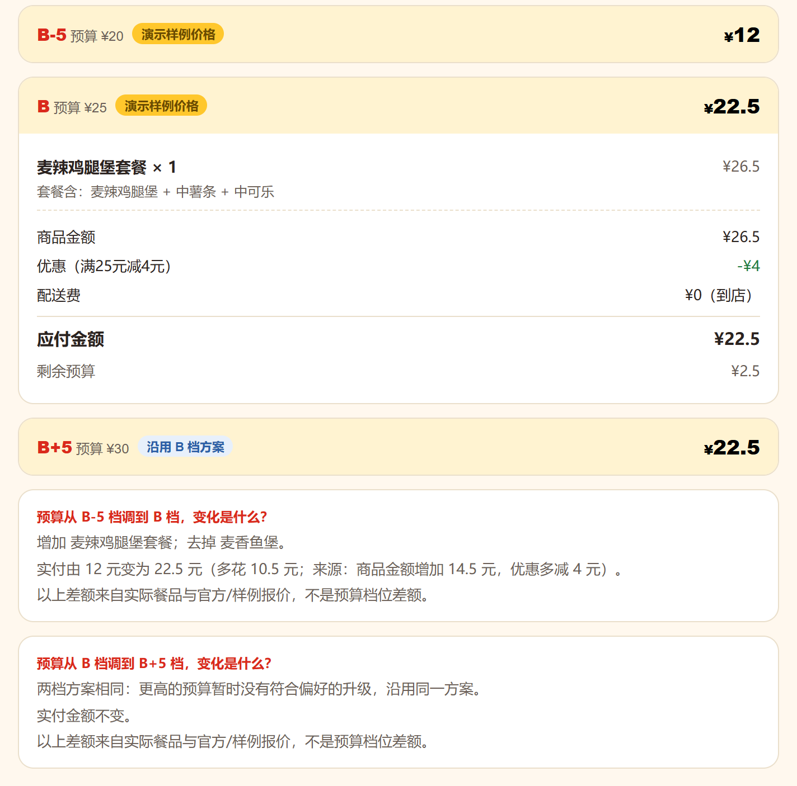
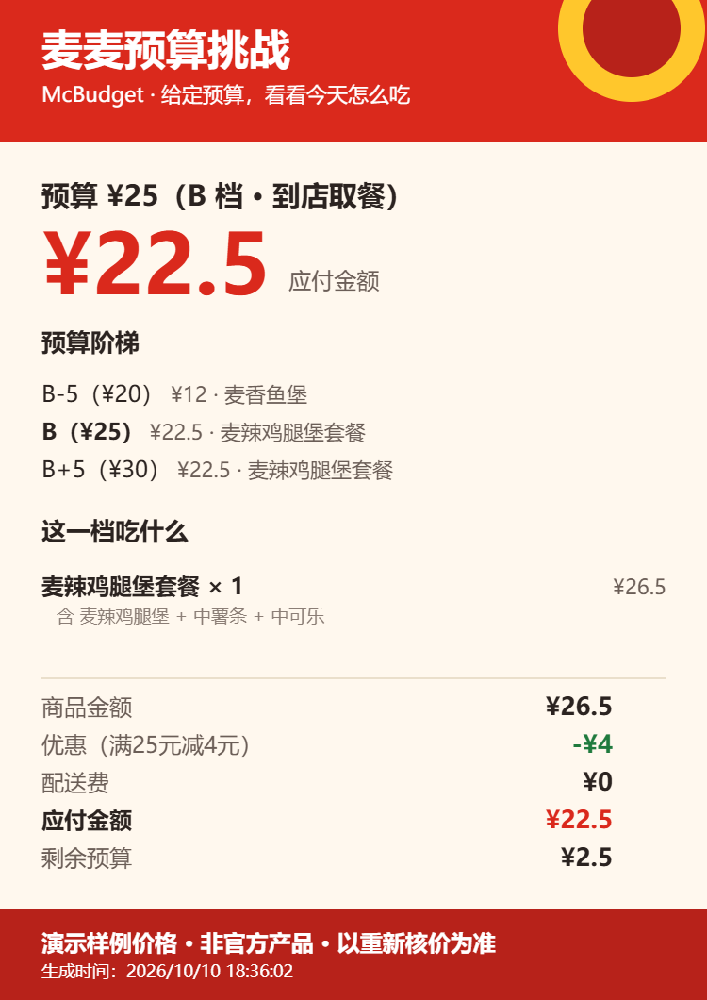

<div align="center">

# 🍔 麦麦预算挑战 · McBudget

**今天午饭 25 元，加 5 元能升级什么？**

💰 给出 **B−5 / B / B＋5** 三档真实餐单，看清餐品变化与应付金额，再决定怎么吃。

[](docs/GETTING_STARTED.md)
[](MCP_INTEGRATION.md#6-真实验证记录)
[](docs/RELEASE_VALIDATION.md)
[](https://ryb792.github.io/mcbudget/demo/)
[](https://github.com/ryb792/mcbudget/releases/latest)
[-2563EB?style=flat-square)](LICENSE)
[](https://github.com/M-China/mcd-developer-innovation-challenge/issues/277#issuecomment-6095413505)

### [📦 下载真实 Skill](https://github.com/ryb792/mcbudget/releases/latest/download/mcbudget.zip)　·　[🚀 安装指引](docs/GETTING_STARTED.md)　·　[▶ 网页试玩](https://ryb792.github.io/mcbudget/demo/)

[功能](#-你可以用它做什么) · [开始使用](#-三步开始真实使用) · [演示效果](#-先在网页看看效果) · [常见问题](#-常见问题) · [English](README.en.md)

</div>

> **Skill 用于真实使用。** 安装后连接你自己的麦当劳 MCP，使用真实门店、菜单和官方核价；未连接时先完成配置。网页试玩是独立的展示入口，使用明确标注的虚构价格，保留在 GitHub，不随 Skill 安装包提供。

## 💡 你可以用它做什么

| 你的需求 | McBudget 给你的结果 |
| --- | --- |
| **午饭有预算，不知道怎么搭配** | B−5 / B / B＋5 三档餐单与官方应付金额 |
| **想知道加 5 元值不值** | 增加、减少或替换的餐品，以及实际付款差额 |
| **想吃鸡肉，不要咖啡** | 按口味、必选餐品和排除项筛选候选 |
| **想用券和积分省钱** | 可选省钱模式：领取免费券，比较积分兑换餐券，再按门店可用券官方核价 |
| **找到合适方案后直接点餐** | 处理优惠、重新核价，确认后创建订单并交付支付链接 |
| **分享今天的预算挑战** | 生成不含个人资料的 PNG 卡片，展示预算、餐品和金额明细 |

适合有午饭预算的办公用户，可在 **WorkBuddy、Codex 等支持 Skill、MCP 和脚本执行的工具**中使用。默认面向单人点餐；到店、得来速或外送先由你选择，外送预算包含配送费。

## 🚀 三步开始真实使用

1. **安装 Skill**：下载 [mcbudget.zip](https://github.com/ryb792/mcbudget/releases/latest/download/mcbudget.zip)，导入你使用的 AI 工具。
2. **连接麦当劳 MCP**：在 [麦当劳开放平台](https://open.mcd.cn) 申请自己的 Token，按[安装指引](docs/GETTING_STARTED.md)配置并验证连接。
3. **说出预算和口味**：查看三档餐单，选定后重新核价、确认下单，再由你完成支付。

| 工具 | 安装方式 |
| --- | --- |
| **WorkBuddy** | 技能 → 添加技能 → 上传技能包 |
| **Codex** | 把完整 `mcbudget/` 放到 `~/.agents/skills/` 或项目 `.agents/skills/`，用 `$mcbudget` 调用 |
| **其他客户端** | 使用本地 Skill 导入入口，保留完整文件夹；配置 Streamable HTTP MCP |

### 💬 复制这句话开始

```text
帮我挑战 25 元午饭，到店取餐，想吃鸡肉汉堡。
给我 B-5 / B / B+5 三档，说明吃什么、应付多少，以及加减 5 元的具体变化。
我选定后，先重新核价，再让我确认下单。
```

也可以说：“外送到我的办公室，总预算 35 元，配送费也算进去，不要咖啡。”

**使用流程：** 选门店与方式 → 获取真实菜单和优惠 → 官方核价 → 比较三档 → 确认下单 → 你完成支付。

领券会改变账户券状态。你请求领券或开启自动领免费券后，技能在每个会话最多执行一次，并刷新当前门店可用券；积分兑换需确认具体商品、积分和数量。开发者已补充确认领券、创建订单及后续支付流程可行；[查看验证来源与记录](MCP_INTEGRATION.md#6-真实验证记录)。

### 💰 开启省钱模式

```text
帮我挑战 25 元午饭，开启省钱模式，自动领取免费券。
看看我的积分有没有适合这顿饭的餐券；先比较，兑换前告诉我商品、积分和数量。
下单后只给餐品、应付金额、门店或收餐信息，以及支付链接。
```

先检查免费券和当前门店可用优惠；你想使用积分时，再读取积分余额、兑换商品和使用条件，优先比较无额外现金的积分餐券。确认兑换后重新查询门店可用券并核价，**积分单独展示，现金应付以官方算价为准**。想尽量少花现金时，可以说“保留鸡肉汉堡，优先实付更低的方案”。不默认购买付费卡或参加积分抽奖。功能依据见[官方 MCP 工具列表](https://github.com/M-China/mcd-mcp-server#3-工具列表)，操作约定见[省钱流程](references/savings.md)。

订单创建成功后，用几行交付 **餐品 × 数量、应付金额、门店与取餐方式或简短收餐地址、支付链接**。详情变化或需要你处理的问题才补充说明。

### ⚡ 更快获得餐单

默认选取最多 **6 个候选**进行官方核价，再生成三档餐单；需要更广的候选比较时，说“多比较一些方案”，本轮最多核价 12 个候选。所有展示的应付金额都来自成功的官方核价。

在同一会话中，门店和就餐方式可以沿用。只调整预算时，优先复用 5 分钟内、完整购物车与业务上下文一致的报价，缺少候选再补充核价。菜单详情只查入选餐品，省钱模式与积分比较按需启用，挑战卡和支付二维码需要时再生成。**选定方案后，下单前仍会重新核价并请你确认。**

```text
把预算改到 30 元，沿用刚才的门店和口味，先用本轮已核价方案重新比较。
```

## 👀 先在网页看看效果

[打开网页试玩 →](https://ryb792.github.io/mcbudget/demo/) 无需账户或 Token，先体验预算阶梯和挑战卡的展示方式。

下面是网页实际生成的 **20 / 25 / 30 元挑战**。三档数字是预算上限，各卡片显示对应的应付金额；高一档沿用方案时，也会说明原因。

<p align="center">
  <a href="https://ryb792.github.io/mcbudget/demo/"></a>
</p>

> 网页使用固定虚构价格和简化优惠规则，始终标记“演示样例价格”。真实 Skill 的餐品、优惠和应付金额来自你选择的门店与官方核价。

<details>
<summary>🖼️ 展开查看网页生成的挑战卡</summary>

<p align="center"></p>

</details>

想在本地查看网页，可以下载[仓库源码](https://github.com/ryb792/mcbudget/archive/refs/heads/main.zip)，解压后打开 `demo/index.html`。发布的 Skill 包仅用于真实使用。

## ❓ 常见问题

**安装 Skill 后没配置 MCP，能直接使用吗？**<br>
先申请 Token、配置连接并验证。技能会提供接入引导，不会自动使用模拟餐品或价格。

**加 5 元一定会多买东西吗？**<br>
预算上限增加不等于实际多付 5 元。没有符合条件的升级时，会沿用当前方案并解释原因。

**为什么第一次运行较慢？**<br>
需要查询真实门店、菜单、餐品详情和优惠，再逐个请求官方核价。v0.3.1 将默认核价候选上限从 12 个降为 6 个，并减少重复查询；实际等待仍取决于网络、官方服务与客户端处理速度。

**什么时候下单和支付？**<br>
选定方案后重新核价，展示门店、餐品和金额，由你确认后创建订单；支付链接交付后由你完成支付。

**开启省钱模式会自动花积分吗？**<br>
不会。自动领券只用于你已授权的免费券；积分先查询和比较，确认兑换商品、积分与数量后才兑换。兑换成功的券还要核实当前门店适用性并重新核价。

**Token 和个人信息会分享到卡片上吗？**<br>
不会。Token 保存在本机，挑战卡不包含手机号、地址、券码、完整订单号或支付链接。

## 📚 文档与参与

| 入口 | 内容 |
| --- | --- |
| [安装与配置](docs/GETTING_STARTED.md) | WorkBuddy、Codex 与通用客户端开始真实使用 |
| [技能流程](SKILL.md) · [MCP 接入](MCP_INTEGRATION.md) | 门店、优惠、核价、订单与支付交付流程 |
| [省钱流程](references/savings.md) | 免费券、积分餐券比较与兑换确认 |
| [开发与验证](docs/DEVELOPMENT.md) · [发布检查](docs/RELEASE_VALIDATION.md) | 源码、独立网页、检查与打包 |
| [最新版本](https://github.com/ryb792/mcbudget/releases/latest) | 真实 Skill 包与更新记录 |
| [反馈问题或提建议](https://github.com/ryb792/mcbudget/issues/new) | 使用问题与新的预算挑战场景 |
| [参赛声明](CONTEST_DECLARATION.md) · [WorkBuddy 开发记录](workbuddy.md) | 官方声明与开发过程 |

如果它帮你解决了午饭预算问题，欢迎 **⭐ Star**，也欢迎在 Issue 中分享你希望支持的点餐场景。

原创代码使用 [MIT 许可](LICENSE)。本项目为麦当劳程序员创意开发大赛参赛作品，非麦当劳官方产品；相关商标归其权利人所有。餐品、价格与供应状态以官方渠道实时结果为准。
